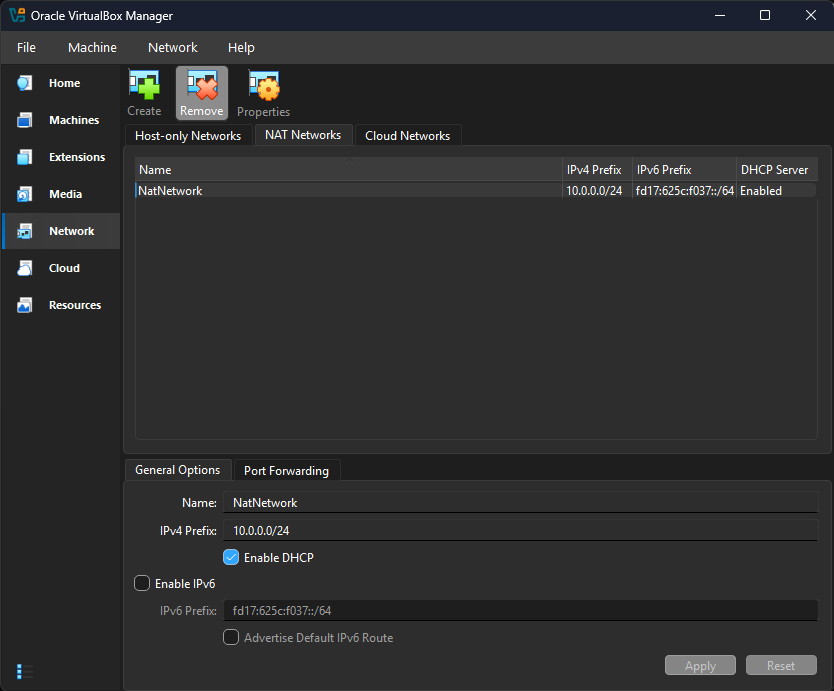
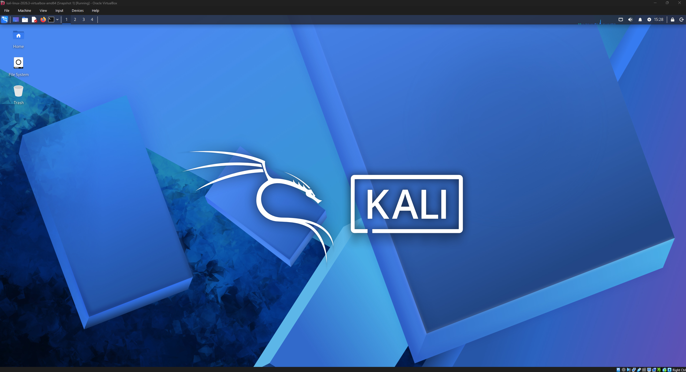
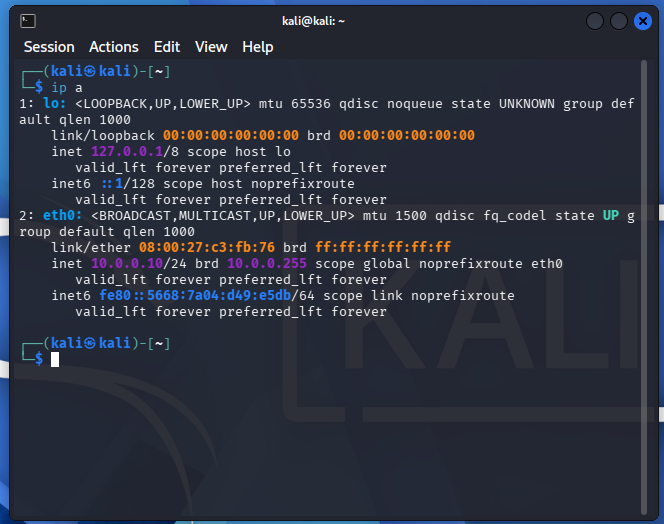
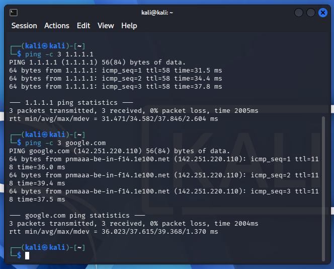
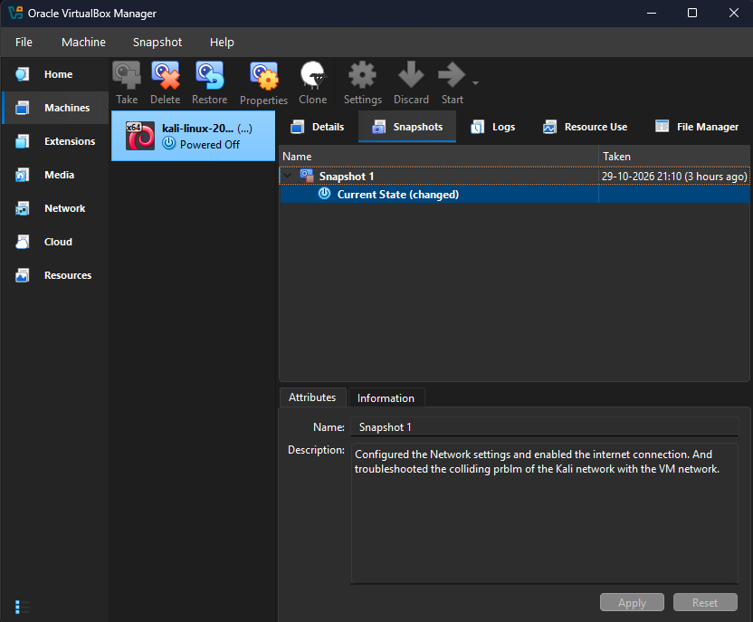
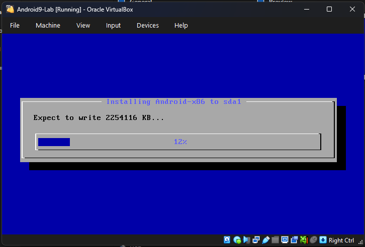

# Cybersecurity Testing Lab Setup (Week 1 - Task WK1-PM1 & WK1-PMx)

## Overview
This repository documents the deployment, configuration, and verification of an isolated virtual cybersecurity testing lab built with Oracle VirtualBox as part of the NetworkWalks Academy Cybersecurity Internship program.

The objective is to establish an isolated virtual subnet capable of hosting both attacking platforms and target machines safely without exposing local network devices, validating end-to-end routing, DNS resolution, and cross-machine reachability.

---

## Lab Architecture & Specifications

| Component | Role | OS / Platform | IP Address | Subnet CIDR |
| :--- | :--- | :--- | :--- | :--- |
| **Hypervisor** | Virtualization Host | Oracle VirtualBox 7.x | — | — |
| **Attacking Machine (WK1-PM1)** | Security Testing Node | Kali Linux (x86_64) | `10.0.0.10` | `10.0.0.0/24` |
| **Target Machine (WK1-PMx)** | Target / Mobile Node | Android-x86 9.0 | `10.0.0.9` | `10.0.0.0/24` |
| **Default Gateway** | Virtual NAT Router | VirtualBox Internal | `10.0.0.1` | `10.0.0.0/24` |

---

## Part 1: Attacking Platform Deployment (Kali Linux)

### 1. Hypervisor & NAT Network Setup
- Configured a dedicated **NAT Network** named `NatNetwork` with IPv4 prefix `10.0.0.0/24`.
- Enabled internal DHCP service for scalable lab target integration.



### 2. Attacking Machine Deployment
- Imported the pre-built Kali Linux 64-bit appliance into VirtualBox.
- Attached Adapter 1 to `NAT Network` (`NatNetwork`).
- Configured bidirectional clipboard sharing and drag-and-drop.
- Configured host-guest shared folders for secure file transfer.



### 3. Static IP Configuration & Routing
- Assigned Kali Linux a static configuration (`10.0.0.10/24`) to avoid reserved address conflicts with the VirtualBox gateway and internal services.
- Verified gateway reachability and external DNS resolution.

```bash
# Verify assigned IP address
ip a

# Test default gateway connectivity
ping -c 3 10.0.0.1

# Test internet routing & DNS resolution
ping -c 3 1.1.1.1
ping -c 3 google.com
```




### 4. Baseline Recovery Snapshot
- Captured an initial, clean-state snapshot (`Snapshot 1`) before running exploits or installing tools.
- Enables instant rollback and deterministic lab testing.



---

## Part 2: Target Integration & Verification (Android-x86)

### 1. Target Deployment & Network Configuration
- Deployed an **Android-x86 9.0 (r2)** virtual appliance attached to the shared `NatNetwork` (`10.0.0.0/24`).
- Partitioned a dedicated 10 GB virtual drive formatted with `ext4` and installed legacy GRUB for full state persistence.
- Assigned a static IP configuration to interface `wlan0`:
  * **IP Address:** `10.0.0.9`
  * **Subnet Mask:** `255.255.255.0` (`/24`)
  * **Gateway:** `10.0.0.1`
  * **Primary DNS:** `8.8.8.8`
- Added explicit default gateway route entries (`ip route add default via 10.0.0.1 dev wlan0`) to ensure routing table persistence.



### 2. Dual-Node Verification & Connectivity Test
Confirmed cross-node connectivity across the isolated subnet as well as external internet access:

```bash
# From Android Terminal:
ping -c 3 10.0.0.10     # Reachability to Kali Attacker
ping -c 3 8.8.8.8       # Outbound Internet Reachability

# From Kali Terminal:
ping -c 3 10.0.0.9      # Reachability to Android Target
```


---

## Key Troubleshooting & Engineering Notes
- **VirtualBox NAT Network IP Reservations:** In a VirtualBox `10.0.0.0/24` NAT Network, addresses `10.0.0.1` through `10.0.0.3` are internally reserved by the hypervisor architecture for default routing, DHCP dispatch, and DNS proxying. Setting client VMs to addresses within this reserved pool causes routing failure upon reboot; shifting hosts to the pool starting at `.4` (e.g., `10.0.0.10` and `10.0.0.9`) eliminates IP collisions and ensures persistent connectivity.
- **Android-x86 Virtual Interface Routing:** Android-x86 exposes the virtualized adapter as `wlan0`. If the interface fails to propagate the default gateway upon static assignment, explicitly defining the gateway using `ip route add default via 10.0.0.1 dev wlan0` resolves the missing route without requiring hypervisor bridge rebuilds.

---

## Author
- **Irfan K**
- Cybersecurity Intern @ NetworkWalks Academy
